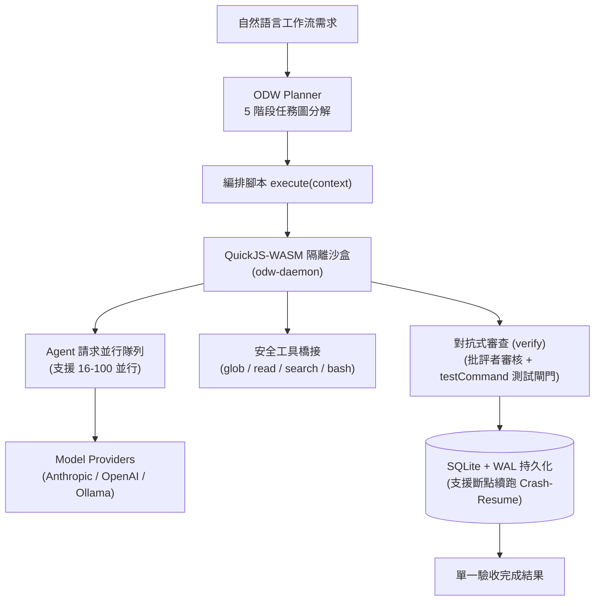

# Open Dynamic Workflows (ODW) 深度研究與完整用法解析

本文件深入梳理 `open-dynamic-workflows`（ODW）架構原始碼，涵蓋從核心理念、腳本沙盒 API、CLI 工具、RESTful/MCP 整合到實戰範例的完整用法。

---

## 一、核心架構與設計理念

傳統多 Agent 系統（如 AutoGen、CrewAI）通常讓主 LLM 在每一輪對話中不斷協調其他子 Agent，這會導致：
1. **Context Window 迅速耗盡**：主 LLM 花費大量 Token 記住其他幾十個 Agent 的進度。
2. **網路阻塞與不可靠**：LLM 記憶隨機漂移，無法處理真正的並行或崩潰復原。

### ODW 的核心哲學：Script-as-orchestrator
- **模型只寫一次腳本**：LLM 只扮演「架構規劃師」，產出一份純 JavaScript 的 `execute(context)` 編排腳本。
- **沙盒負責真實調度**：本機 Daemon 將腳本載入 WebAssembly 隔離的 **QuickJS 沙盒** 執行。沙盒原生提供並行隊列（16～100+ 並行）、安全檔案/Shell 工具調用、對抗審查機制與 SQLite 狀態持久化。
- **對話框只接收最終結果**：主對話視窗不會被大量 Agent 的雜訊灌爆，只在最後取得驗收後的結論。



---

## 二、沙盒原生執行原語（Sandbox Primitives）

在 ODW 沙盒腳本中，沒有 Node.js 的 `process`、`fs` 或 `network`，所有操作均透過嚴格受控的原語進行：

### 1. `agent(options)`
最基礎的調度單元。將 Prompt 打包送入並行隊列由 LLM 執行：
```javascript
const result = await agent({
  role: "security-auditor",       // 角色名稱（對應系統提示詞）
  prompt: "檢查 index.ts 是否有未驗證漏洞",
  schema: {                       // 強制結構化輸出（JSON Schema）
    findings: "array",
    confidence: "number"
  },
  model: "planning",             // 可指定模型別名 (planning / default / fallback) 或模型全名
  tools: ["read_file", "search"], // 允許該 Agent 呼叫的工具白名單
  maxTokens: 4000,
  timeout: 120                   // 秒數
});
```

### 2. `parallel(tasks, options)`
限制最大並行數的高效並行處理：
```javascript
const findings = await parallel(
  files.map(file => () => agent({
    role: "code-analyzer",
    prompt: `分析 ${file}`,
    tools: ["read_file"]
  })),
  { maxConcurrency: 16 } // 最大並行數
);
```

### 3. `pipeline(items, stages)`
無障礙串流管線（每個 item 獨立走完所有 stage）：
```javascript
const migrated = await pipeline(files, [
  async (file) => await agent({ prompt: `步驟 1: 解析 ${file}` }),
  async (step1Result) => await agent({ prompt: `步驟 2: 重構程式碼` }),
  async (step2Result) => await agent({ prompt: `步驟 3: 格式化驗證` })
]);
```

### 4. `verify(config)` —— 對抗式審查機制
ODW 最具特色的品質把關原語。預設不信任單一 Agent 產出的結果，引入多位懷疑者（Critics）或測試命令進行交叉審查：
```javascript
const verified = await verify({
  target: findings,               // 待審查目標
  mode: "adversarial",           // "adversarial" (多數決反對才淘汰) 或 "consensus" (需多數贊成)
  critics: [
    { role: "false-positive-hunter", prompt: "抓出假陽性，假設 20% 是誤判", model: "default" },
    { role: "severity-validator",    prompt: "挑戰嚴重性評級是否虛高",     model: "planning" },
    { role: "completeness-checker",  prompt: "找出遺漏未檢查的情境",         model: "fallback" }
  ],
  consensusThreshold: 2,         // 通過門檻
  minConfidence: 0.8,
  testCommand: "npm test"        // (可選) 測試閘門：自動在本地執行測試，exitCode 0 才算過關
});
```

### 5. `checkpoint(data)` 與 `replan(prompt, options)`
- **`checkpoint(data)`**：寫入 SQLite WAL 快照。若行程中斷，下次以 `--resume` 啟動時直接從快照讀取，不重複燒 Token。
- **`replan(prompt, options)`**：動態重新規劃。當發現現有計劃已無法符合現況時，腳本可要求主機端 Planner 產出子計劃並接續執行。

### 6. `context.tools` —— 受控環境工具
腳本可直接調用檔案與系統操作：
- `await context.tools.glob("src/**/*.{js,ts}")`：搜尋檔案路徑清單。
- `await context.tools.read_file("path")`：讀取 UTF-8 檔案。
- `await context.tools.search({ pattern: "TODO", glob: "src/**" })`：全專案 Regex 搜尋。
- `await context.tools.write_file({ path: "...", content: "..." })`：（需設定許可）寫入檔案。
- `await context.tools.run_bash("npm test")`：（需設定許可）執行 Shell 指令。
- `await context.tools.web_search({ query: "..." })` / `web_fetch({ url: "..." })`：網頁搜尋與擷取。

---

## 三、設定檔詳細規格 (`~/.odw/config.json`)

```json
{
  "daemon": {
    "port": 7345,
    "maxConcurrency": 16,
    "logLevel": "info"
  },
  "auth": {
    "mode": "token"
  },
  "apiKeys": {
    "anthropic": "sk-ant-...",
    "openai": "sk-...",
    "deepseek": "sk-..."
  },
  "baseURLs": {
    "ollama": "http://127.0.0.1:11434",
    "deepseek": "https://api.deepseek.com/v1"
  },
  "models": {
    "planning": "claude-opus-5-5",          // 高階難題規劃、對抗審查嚴格把關
    "default": "claude-sonnet-5-5",         // 主要實作與深入分析
    "fallback": "ollama:qwen3-coder:latest" // 初探掃描、大量檔案篩選（走本機免 Token 費）
  },
  "budget": {
    "defaultMaxTokens": 1000000,
    "defaultMaxCostUSD": 50,
    "alertAtPercent": 80
  },
  "safety": {
    "requireApprovalFor": ["write_file", "run_bash", "git_commit"],
    "autoApproveReadOnly": true,
    "dryRun": false
  }
}
```

---

## 四、命令列（CLI）與各介面使用方式

### 1. 守護程序管理 (Daemon Management)
```bash
odw-daemon start       # 背景啟動 Daemon
odw-daemon status      # 查看健康狀態與活躍工作流
odw-daemon stop        # 停止 Daemon
odw-daemon restart     # 重啟 Daemon (若有中斷的工作流可自動續跑)
odw-daemon logs        # 檢視執行日誌 (~/.odw/logs/daemon.log)
odw-daemon doctor all  # 診斷所有已安裝的 Agent 整合與 Daemon 連線狀態
```

### 2. 終端機執行工作流
```bash
# 方式 A：由自然語言動態規劃並執行
odw-daemon run --prompt "workflow: 掃描整個專案所有 API 端點是否有缺漏驗證" --cwd ./my-project

# 方式 B：直接執行保存的編排腳本
odw-daemon run --script examples/workflows/security-audit.js --cwd ./my-project
```

### 3. RESTful HTTP API (供自製前端或 CI/CD 串接)
Daemon 預設監聽在 `http://127.0.0.1:7345`，Header 帶入 `Authorization: Bearer <~/.odw/daemon.token>`：
- **`GET /health`**：免認證健康檢查與活躍 Agent 計數。
- **`POST /workflows/plan`**：傳入 `{ prompt: "..." }`，取得分解後的 TaskGraph 與編譯腳本。
- **`POST /workflows/exec`**：傳入 `{ plan: { script: "..." }, cwd: "..." }`，非同步啟動工作流並回傳 `workflowId`。
- **`GET /workflows/:id`**：查詢目前進度、階段（phase）與已完成節點統計。
- **`GET /workflows/:id/result`**：長輪詢取得最終產出結果。
- **`POST /workflows/:id/pause` | `resume` | `stop`**：工作流執行緒控制。

### 4. MCP Server 整合 (供 Antigravity、Cursor、Codex、VS Code 使用)
ODW 提供標準的 Stdio MCP 橋接器（`odw-mcp-server`）：
- 開放工具：`odw_health`、`odw_plan`、`odw_run`、`odw_status`、`odw_result`、`odw_control`。
- 只要在各 Agent 的提示詞開頭輸入 `workflow:` 或 `ultracode`，就會自動透過 MCP 發起後端編排。

---

## 五、完整編排腳本實例（以安全稽核為例）

以下為一個標準的 `audit.workflow.js`：

```javascript
async function execute(context) {
  // 階段 1：探勘 (Discovery)
  phase("Discovery", { estimatedAgents: 1 });
  const files = await context.tools.glob("src/routes/**/*.{js,ts}");
  log(`已發現 ${files.length} 個路由檔案`);
  await checkpoint({ phase: "discovery", files });

  // 階段 2：並行分析 (MapReduce)
  phase("Audit", { estimatedAgents: files.length });
  const findings = await parallel(
    files.map(f => () => agent({
      role: "analysis-agent",
      prompt: `檢查 ${f} 是否有缺漏身份驗證或 SQL 注入風險。回傳 JSON: { file: string, findings: array, confidence: number }`,
      schema: { file: "string", findings: "array", confidence: "number" },
      tools: ["read_file"],
      model: "default",
      maxTokens: 4000
    })),
    { maxConcurrency: 16 }
  );
  await checkpoint({ phase: "audit", findings });

  // 階段 3：對抗式嚴格驗收 (Verification)
  phase("Verification", { estimatedAgents: 2 });
  const verified = await verify({
    target: findings,
    mode: "adversarial",
    critics: [
      { role: "false-positive-hunter", prompt: "淘汰所有不可行或誤報的漏洞", model: "default" },
      { role: "severity-validator",    prompt: "評估真實資安衝擊程度",       model: "planning" }
    ],
    consensusThreshold: 2,
    minConfidence: 0.8
  });
  await checkpoint({ phase: "verification", verified });

  // 階段 4：成果彙整 (Synthesis)
  phase("Synthesis", { estimatedAgents: 1 });
  return agent({
    role: "synthesis-agent",
    prompt: `根據以下驗收通過的清單產出專業資安稽核報告：${JSON.stringify(verified)}`,
    schema: { summary: "string", criticalCount: "number", actionItems: "array" },
    model: "planning"
  });
}

module.exports = { execute };
```
